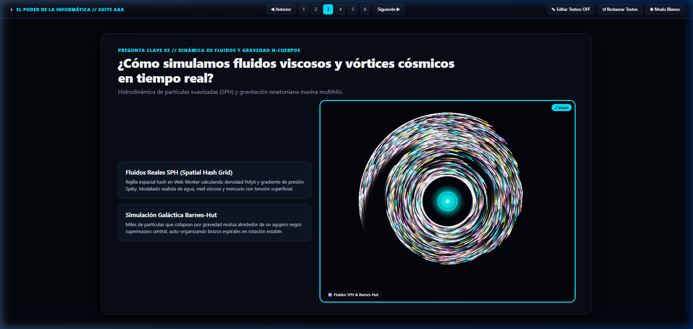

# 🌌 Suite de Computación Gráfica, Física de Fluidos SPH & Simulaciones Científicas

[](https://developer.mozilla.org/es/docs/Web/HTML)
[](https://developer.mozilla.org/es/docs/Web/JavaScript)
[](https://developer.mozilla.org/es/docs/Web/API/Web_Workers_API)
[](https://developer.mozilla.org/es/docs/Web/API/Web_Audio_API)
[-success?style=for-the-badge)](https://github.com)
[](https://pages.github.com)

Una plataforma interactiva de **alto rendimiento gráfico** y **física computacional** diseñada para divulgación científica de vanguardia y exposiciones académicas interactivas.

Todos los motores han sido desarrollados en **Vanilla JavaScript nativo** sin librerías externas ni dependencias pesadas, aprovechando al máximo aceleración por **Web Workers multihilo**, arquitectura de memoria **Structure of Arrays (SoA)**, síntesis de audio espacial 3D y renderizado matemático en tiempo real a 60–120 FPS.

---

## 📸 Vista Previa de la Suite



---

## 🚀 Despliegue Inmediato (GitHub Pages)

Este repositorio está optimizado para funcionar como una aplicación web estática instantánea sin necesidad de compilación:

1. Ve a los **Settings** (Ajustes) de tu repositorio en GitHub.
2. Navega a la pestaña **Pages** en la barra lateral izquierda.
3. En **Branch**, selecciona `main` y la carpeta `/(root)`.
4. Haz clic en **Save**. ¡Tu presentación estará activa en la URL de GitHub Pages!

Para ejecutarlo localmente en tu ordenador:
- Simplemente haz doble clic en `index.html` en cualquier navegador moderno (Chrome, Edge, Firefox, Brave), o utiliza un servidor estático:
```bash
npx serve .
```

---

## 🔬 Arquitectura de los 4 Motores Científicos

### 1. 🧠 Red Neuronal 3D, Óptica Cinematográfica & Audio Espacial
- **Ubicación:** [`cerebro 3d/3d2.html`](cerebro%203d/3d2.html)
- **Tecnologías:**
  - **Audio Espacial 3D (Web Audio API):** Nodos posicionales `PannerNode` tridimensionales que calculan atenuación y balance estéreo en función de las coordenadas $(X, Y, Z)$ relativas a la cámara al propagarse impulsos sinápticos.
  - **Profundidad de Campo (DoF / Bokeh):** Desenfoque cinemático según la distancia al plano focal $|Z - Z_{\text{foco}}|$.
  - **Triangulación Dinámica de Delaunay 3D:** Mapeo de facetas poligonales semitransparentes en tiempo real entre los nodos más próximos.
  - **Modelos Tridimensionales Intercambiables:**
    1. *Red Conectoma Cerebral* (5 hemisferios con asignación de color dinámico).
    2. *Sistema Solar Kepleriano* (órbitas planetarias a escala).
    3. *Jardín de Flores Fractales* (morfología matemática continua).

---

### 2. ⚛️ Física de Fluidos SPH, Galaxia Barnes-Hut & Vórtice Kepleriano
- **Ubicación:** [`html fisica de interacciones/index.html`](html%20fisica%20de%20interacciones/index.html)
- **Tecnologías:**
  - **Web Worker a 120 Hz con Doble Búfer Zero-Copy:** Hilo secundario dedicado al cálculo matricial que no bloquea el hilo de renderizado.
  - **SPH (Smoothed Particle Hydrodynamics):** Simulación de fluidos reales mediante una Rejilla Hash Espacial $O(N)$ con kernel Poly6 y gradiente de presión Spiky. Modela agua líquida, miel densa de alta viscosidad y mercurio con tensión superficial.
  - **N-Cuerpos Barnes-Hut (Cosmos Galáctico):** Cuadriculado espacial de macroceldas para cálculo gravitacional a gran escala alrededor de un agujero negro supermasivo.
  - **Vórtice Orbital Kepleriano Estable:** Mecánica polar con aceleración centrípeta exacta $a_c = \frac{v^2}{r}$ y amortiguamiento radial activo, manteniendo un disco multi-anillo balanceado e interactivo con el ratón.

---

### 3. 🧬 Autómatas Celulares Continuos (Lenia) & Morfogénesis de Turing
- **Ubicación:** [`html juego de vida automata/index.html`](html%20juego%20de%20vida%20automata/index.html)
- **Tecnologías:**
  - **Lenia Bidimensional:** Generalización continua del Juego de la Vida de Conway basada en funciones de crecimiento gaussianas y núcleos de convolución radial múltiple.
  - **Ecuaciones de Reacción-Difusión de Turing:** Modelado matemático de manchas, bandas biológicas y biogénesis morfológica auto-regulada.

---

### 4. 🧭 Algoritmos de Navegación A* & Motor Raycasting 3D
- **Ubicación:** [`html juego laberito/index.html`](html%20juego%20laberito/index.html)
- **Tecnologías:**
  - **Generación Procedural de Laberintos:** Algoritmo DFS recursivo con backtracking y prim probabilístico.
  - **Pathfinding A*:** Búsqueda informada en tiempo real con cola de prioridad y heurística euclidiana/Manhattan.
  - **Motor Raycasting 3D:** Proyección volumétrica en primera persona estilo retro, corrección geométrica de distorsión de ojo de pez y gradientes de niebla lumínica por distancia euclidiana.

---

## 🖥️ Suite de Presentación Interactiva (`index.html`)

- **Modo Simulación Pura:** En las diapositivas de exposición, las ventanas de visualización ocultan automáticamente menús y barras de estado, proyectando simulaciones limpias y fluidas.
- **Interacción Directa con el Ratón:** Todas las ventanas permiten arrastre de nodos, perturbaciones por ondas de cursor y controles táctiles directamente sobre el lienzo.
- **Botón ⤢ Zoom:** Expande cualquier motor a un modal inmersivo a pantalla completa sin salir de la diapositiva.
- **Conmutador de Tema Claro / Oscuro:** Paleta cromática optimizada para auditorios iluminados o salas oscuras.
- **Edición en Vivo con Persistencia:** Permite editar los textos de la exposición sobre la marcha y los guarda automáticamente en el `localStorage` del navegador.
- **Launcher Laboratorio:** Diapositiva 6 con acceso directo a los paneles de control e inspectores completos de cada motor.

---

## 📂 Estructura del Repositorio

```
├── index.html                         # Entrada principal (Presentación y GitHub Pages)
├── diapo.html                         # Presentación interactiva
├── launcher.html                      # Hub / Lanzador de laboratorios
├── README.md                          # Documentación completa y guía de arquitectura
├── .gitignore                         # Exclusión de archivos temporales y del sistema
├── assets/
│   └── screenshots/
│       └── showcase_slide3.png        # Captura de demostración de la suite
├── cerebro 3d/
│   └── 3d2.html                       # Motor 3D Red Neuronal + Audio Espacial
├── html fisica de interacciones/
│   └── index.html                     # Motor SPH Fluidos, Vórtice & Barnes-Hut
├── html juego de vida automata/
│   └── index.html                     # Motor Lenia & Reacción-Difusión
└── html juego laberito/
    └── index.html                     # Motor A* Pathfinder & Raycasting 3D
```

---

## 📄 Licencia

Este proyecto se distribuye bajo la licencia **MIT**. Puedes usarlo, modificarlo y compartirlo libremente para fines educativos, académicos o profesionales.
